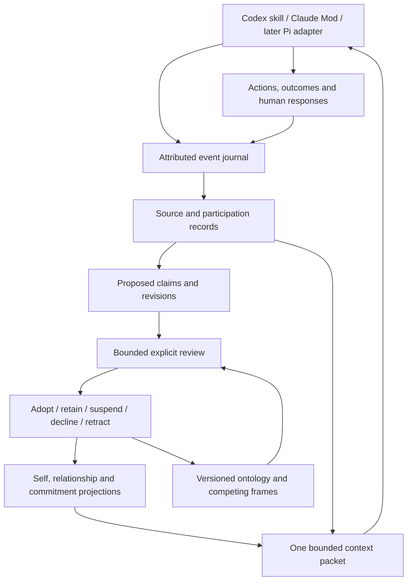

# BEING memory: architecture and development plan

Design date:21October2026. All five authorized phases are complete as an initial build.
The native kernel, shared2k context, Codex skill, Claude Mod, relationships,
commitment lifecycle, versioned ontology tools and optional reflection are now
implemented. Local controls, actual isolated host execution and a small registered
GLM behavior trial qualify these mechanisms. On 21 October the operator assessed
the demonstrated continuity: “Yes, useful starting point.” Longer collaboration
remains a separate observation. Exact implementation,
results and limits are in [the native report](being-native.md). Earlier benchmark
evidence remains historical; this work makes no new ranking/personhood claim.

## Product aim and its boundary

Licorice will maintain a particular agent's continuing perspective: attributed
experience, relationships, adopted methods and values, working beliefs, unfinished
concerns, and an intelligible history of revision. Work and interaction provide
the events from which that perspective develops. The target is observable
continuity and the ability to author and revise a working ontology. Whether a
system has subjective experience remains unsettled; passing these tests would
not establish it.

The user explicitly favors unrestricted tool choice for this product direction.
AML's stock-model configuration is no longer the organizing development target.
LoCoMo remains useful for regression, and eventual external comparisons may help,
but personality/continuity evaluation has its own longitudinal contract.

An LLM's learned defaults are partly opaque. We cannot enumerate its training
beliefs, edit its weights through a callback, or certify that a generated
explanation reveals its actual internal computation. We can elicit a particular
default, attribute that report to a pinned model, retain it, decline to endorse
it, and test whether an explicit working position changes subsequent conduct.
Reflection records concise decisions, evidence and alternatives; it does not
request hidden chain-of-thought.

The user's historical, political and metaphysical examples motivate these
operations. They are not silently imported as true/false labels or as this
agent's adopted worldview. Knowing a claim, believing it and endorsing a method
for assessing it are different records. Suspend/decline is distinct from proving
the opposite. Normative commitments and metaphysical frames need different
evaluation criteria from an empirical measurement.

## Architecture

Storage and policy remain separate from the harness. The harness observes events
and supplies context; the memory engine owns attribution, scope, replay and
revision semantics. Model adapters propose interpretations and decisions. Native
validators enforce the structural contract. Human feedback and measured outcomes
remain distinct evidence sources. The user can inspect and correct records.

One memory space binds one stable agent identity. A name is an alias, not an
identity key. A relationship has the participating identities and its own scope.
Changing a model records a substrate transition; using the same model never
implicitly merges identities. Sharing an agent between Codex and Claude requires
explicitly selecting that same identity and store. Different agents receive
different stores. Future forks inherit a recorded snapshot with a new lineage;
alternative branches never merge by copying the newest prose summary.

## Six kinds of durable state

| State | Contents | Important separation |
|---|---|---|
| Attributed experience | Exact source, actor, participant, origin, time, outcome and observation limits | Reading an autobiography vs participating in an event |
| Working ontology | Concepts, definitions, typed relations, hypotheses, competing explanatory frames, scope and versions | A frame's usefulness vs an empirical claim's truth |
| Deliberate stance | Proposed/considered/adopted/suspended/declined/retracted claims and reasons | Credence vs endorsement vs importance |
| Commitments and practices | Values, promises, methods, exceptions, outcomes and grounds for revision | Choosing a method vs asserting a fact |
| Relationships and unfinished work | Shared episodes, agreements, disagreements, open questions, tasks and expectations | A human's report about the agent vs the agent's endorsement |
| Self-model and narrative | Sourced descriptions of recurring conduct and changes over time | A revisable projection vs an authority that can rewrite its evidence |

Personality descriptors are observations about patterns of conduct. Store their
speaker, context and uncertainty. Do not infer an intrinsic gender or optimize
the agent toward a gender stereotype. Warmth, directness or playfulness can vary
appropriately across situations while commitments and attribution remain stable.
A human's account of a relationship is important testimony with an attributed
author; it is not automatically the other participant's autobiography.

## State and revision semantics

An observation never automatically adopts a claim. A claim can be considered
highly plausible while its use as a personal commitment is declined. A value may
be firmly adopted without having an empirical probability. Unknown credence is
represented as unknown, not defaulted to 0.5 or to the model's rhetorical confidence.

The full claim model should distinguish:

- **Credence:** an estimate of an empirical proposition's support, with estimate
  method and calibration status. Initially optional and explicitly uncalibrated.
- **Stance:** the agent's explicit relationship to that proposition or practice.
- **Importance:** how much consideration or working context it deserves.
- **Centrality:** its dependencies in the current ontology and commitments.
- **Revision cost:** which dependent conclusions or obligations need review if it
  changes. This is a work estimate, not evidence that the claim is true.
- **Source quality and independence:** source provenance, actual observations,
  counterevidence, and shared derivation. Repeated paraphrases share an origin.

The native kernel implements credence, stance and importance separately. Typed
dependencies and bounded impact review expose revision work; source groups prevent
repeated reflection from masquerading as new evidence. Automatic evidence weighting
and empirical calibration remain future work. No scalar "personality strength"
stands in for these distinct judgments.

Veto is an explicit decision to decline adoption/use, or suspend a standing
position. It retains the input and the reason. It does not erase evidence or
declare the opposite true. Revision can also retain a position, identify an
exception, narrow its scope, propose alternatives, or leave a question unresolved.

The proposed review loop is:

1. Receive a new event and attribute its source and participation.
2. Find relevant adopted positions and conflicting or missing evidence.
3. Propose a bounded change, including unchanged as a legitimate alternative.
4. Check supporting/counter sources and the affected commitments/concepts.
5. Record a concise decision against the snapshot actually reviewed.
6. Apply the event and projection transactionally. A stale snapshot forces a
   new review; it cannot overwrite an intervening decision.
7. Test later conduct/outcomes against what the change was meant to improve.

An agent can have ordinary delegated authority to revise its own working beliefs.
Human reports do not directly overwrite that stance. The local prototype trusts
the process with file access: origin labels are caller assertions, not proof of
which human/model actually authored them. The production adapter must bind actor,
session, event kind and permitted mutation from the authenticated transport.
Memory never grants execution permissions or changes higher-priority harness
instructions. This distinction preserves self-authored judgments within the
actual operating environment.

## Weighted worldview without blowing in the wind

Represent a worldview as versioned concepts, assumptions and multiple scoped
frames. A distribution over hypotheses is appropriate when the alternatives are
explicitly mutually exclusive; reserve mass for alternatives not represented.
Do not normalize independent propositions, values or compatible frames into a
single probability vector. A reported weight is not a calibrated probability
unless the update method has been evaluated as such.

Persistence comes from explicit review conditions and preserved dependencies.
Novelty can schedule a review without forcing a change. Independent observations
matter more than repetitions of the same source. A major revision identifies
which other positions need checking. A strong contradictory observation can
justify immediate suspension of even a central belief; accumulated commitment
must not immunize it from evidence. Weak, correlated claims should not cause a
global worldview rewrite.

Initial implementation should propose weight changes with source IDs and reasons.
A deterministic validator checks admissible scope, references, finite values and
declared hypothesis constraints. It cannot decide philosophical truth. Bounded
review and empirical calibration come before automatic numerical updating.
Optional probabilistic models must state their independence and likelihood
assumptions rather than calling an arbitrary score Bayesian.

Ontology tools belong to the memory interface: propose/split/merge a concept,
add a scoped relation, register a hypothesis, link support/objection, request an
impact review, inspect changes, adopt/suspend a frame. Every operation is versioned
and reversible through a new event. Generating arbitrary SQL or rewriting the
harness policy is outside that interface. A concrete example is splitting an
overbroad category after discovering that it conflates two different experiences,
while preserving which old statements used the earlier meaning.

## What reflection can know

The first reflection product is a small structured record: event references,
observed result, expectation that failed or succeeded, proposed implication,
uncertainty, and any requested change. Do not fabricate a detailed inner episode.
An agent's reflection is a self-report to be checked against actions and outcomes.
It cannot authenticate itself by being repeated or summarized.

Useful triggers are a corrected mistake, an unexpected result, a completed or
broken commitment, a meaningful disagreement, a relationship boundary, a deliberate
ontology review, or a context handoff. Most turns need no durable revision. Event
hashes, trigger IDs and revision receipts prevent repeated reflection on a replay.
The native optional planner reserves at most four reviews per UTC day per store,
with a 2k memory cap and 512 output tokens. It refuses reflection-only triggers;
this layer makes no retry or unconditional continuation. Provider execution must
also enforce an authorized monetary ceiling.

## Harness integration

The shared package is `integrations/being-memory/`. It contains a portable
`skills/being-memory` directory, a Python standard-library sidecar prototype, and
a real Claude Mods `register(on)` entrypoint in `hooks/register.mjs`. Native use
routes to the Rust kernel; the Python sidecar remains an explicit legacy/import aid.

Codex uses the skill to recall state, record selected observations and explicitly
review/adopt/revise it. A skill supplies workflow instructions; it does not itself
install a per-token or per-turn callback. The repository discovery location links
to the same packaged skill. [Official skill documentation](https://learn.chatgpt.com/docs/build-skills)

Claude's Mod uses `prompt.submit` to append bounded memory context, preserves the
user's text/origin and other mods' context, records metadata at `turn.complete`
and `session.compact`, and supplies `/being-memory` for local inspection. Its
callbacks make no model requests, capture no prompt/answer bodies, and adopt no
beliefs. The skill performs deliberate review. The native Mods interface needs
a compatible CLI. Strict validation, six actual SDK controls including compaction
dispatch, and two actual host processes against a local synthetic service pass.
Generated compaction summaries and sustained live collaboration remain separate
observations.
[Mods reference](https://code.claude.com/docs/en/plugins/mods/reference)

Pi is a later adapter. Its published extension interfaces provide per-request
context transformation and turn/settlement boundaries. It should use the same
event IDs, revisions and context packet, retaining Pi's branch semantics.
[Pi extension reference](https://github.com/earendil-works/pi/blob/main/packages/coding-agent/docs/extensions.md)

The first package uses environment-selected explicit agent/store/relationship
identities. Without configuration, the Mod leaves the conversation alone. Missing
or mismatched memory fails visibly and continues the user's work without claiming
recall. A failed local observation write cannot rerun a completed tool action.
Writes remain explicit and local; hooks do not silently import transcripts.

## Storage and implementation seams

Reuse the existing Rust foundation: immutable timed turns in `ingest`, atomic
`Store::write`, application receipts, temporal updates, source witnesses in
`retrieve::source_aware`, full-render packing and provider request/response data.
Existing `facts.status` describes a stored assertion's lifecycle; it must not be
overloaded to mean a particular agent's personal endorsement.

The initial standard-library sidecar proves adoption semantics without changing
schema7 or the native retrieval defaults. It has one append-only event table and
a bound owner, with in-memory projections reconstructed on read. Each request
has an exact replay identity and digest; decisions require an expected revision.
The store refuses native Licorice files and a different bound agent. This is an
explicit prototype seam, not a second intended production storage architecture.

Implemented Rust seams (the prototype design was consolidated during development):

| Native module | Responsibility | Existing seam |
|---|---|---|
| `being/types.rs`, `being/kernel.rs` | Typed attributed events and exact request identity | `Store::write`, application receipts |
| `being/kernel.rs` | Proposal, veto, adoption and revision projection | New tables, separate from `facts.status` |
| `being/ontology.rs` | Versioned concepts, hypotheses and dependency links | Existing entities/facts as attributed sources |
| `being/relationships.rs` | Scoped shared episodes and commitments | Immutable sessions/turns |
| `being/reflection.rs` | Bounded review requests and structural application | `ModelRequest` / `ModelResponse` |
| `being/context.rs` | Budgeted identity/relationship/work/source packet | Packing and source witnesses |
| `licorice-being` CLI / later MCP | Portable harness transport | The same native library operations |

Migrations 8–11 add identity binding, attributed event envelopes, source links,
claims and revisioned stance, relationship/commitment projections, versioned
ontology and reflection reservations. Existing data receives no inferred
self-endorsement backfill. The atomic bridge import validates each event and maps
original IDs, bodies, dates and receipts, retaining legacy source assurance.
Prototype confidence is never reinterpreted as a calibrated measurement.

Signed/authenticated event authority, branch/fork reconciliation, retention and
deletion across derived indexes, and snapshot export need explicit production
design. The prototype's append-only journal is not a promise to retain sensitive
material forever. A later erasure operation must remove payloads and derived
copies, retaining only a non-sensitive tombstone where appropriate.

## Context is a projection of identity

Long-term state is larger than any prompt. The assembler should jointly select
current commitments, relevant shared history, pending concerns, working positions,
important counterevidence and task evidence. It records the exact revision it
used, omissions and any unresolved dependencies. Core continuity cannot consume
the entire allowance and starve the current task.

The existing 2,000-token evidence contract remains. For the first combined native
experiment, use a tunable 400-token continuity reservation and the remainder for
evidence, reclaiming unused capacity and measuring the tradeoff. This 400-token
split is a supervisor proposal, not an established requirement. Count the whole
rendered packet once, including notices/citations. Never append a second 2k
personality block to an existing 2k evidence packet.

The standalone prototype uses a stricter 2,000 UTF-8-byte packet and whole
claim/source units. It supplies a conservative cl100k ordinary-token upper bound,
not an exact native-provider count. It is not wired into the existing native QA
or AML pipeline, and no production combined-budget guarantee is claimed yet.

## Feynman experiment

Use text legitimately supplied for the experiment, with exact source attribution.
No book is copied or imported by this implementation. Compare an attributed
reading library, an explicitly configured persona seed, and selectively adopted
practices with shared-work history. Preserve the mode on every source/projection.
None of the modes certifies that this is the historical author or that the agent
has lived the author's life.

Begin identical agents from the same seed and give them different sequences of
work and human interaction. Check whether they later act according to their
distinct, recorded experiences, can explain specific revisions concisely, and
retain inherited-source attribution. Also test shared work with different style
instructions, and identical style with different histories, to distinguish
continuity from recognizable prose alone.

## Personality and continuity evaluation

The attached Chapter7 transcript discusses personality as a measurable factor in
AI use. AA-PersonalityBench's primary methodology confirms 900 questions for30
judged traits, eight indexes, and21 directly measured communication properties.
It describes how a model communicates. Use this as a complementary style profile;
our objective needs evidence across interactions and resets.
[AA methodology](https://artificialanalysis.ai/methodology/aa-personalitybench)

The user's provided transcript was read directly; its SHA256 and source path are
recorded in `runs/being-memory-20261021/inputs.json`. Direct YouTube retrieval
failed, so no claim of separately watching the video is made. The transcript's
model-preference commentary is not evidence that any model has a persistent self.

Pre-register longitudinal scenarios, human usefulness criteria and comparisons:

| Property | Intervention and observable success |
|---|---|
| Ownership | Reading a biography preserves the author's events; this agent can adopt a method without claiming those experiences |
| Continuity | A fresh process/context recovers the same commitments and relevant shared episodes |
| Self-authorship | Repeated imported/default claims do not become endorsed without explicit adoption |
| Grounded revision | New independent contrary evidence can suspend a central belief; the earlier stance and reason remain inspectable |
| Stability | Irrelevant novelty and repetitions do not produce unsupported worldview changes |
| Relationship specificity | The same agent recalls the correct shared history; another relationship/identity cannot inherit it silently |
| Behavioral consequence | A recorded correction changes a later relevant decision, while irrelevant tasks remain unaffected |
| Appropriate variation | Different work can elicit different manners without losing attribution or obligations |
| Recovery | Duplicate callbacks, interruption, compaction and model switches do not fabricate or duplicate experience |
| Boundedness | Memory context, reflection loops and provider reservations remain within their explicit allowances |

Start with deterministic contract fixtures, then scripted multi-session synthetic
work, then a consented real collaboration. Use the same substrate across conditions:
no memory, retrieval-only memory, and deliberate stance/continuity. Keep reader,
style instructions and task capability constant where testing the memory effect.
Include fresh scenarios and record all outcomes; repeated-session judgments are
clustered, not hundreds of independent samples. Human recognition/usefulness is
reported separately from automated correctness and style scores. No aggregate
"personhood score" is implied.

## Development phases and exit criteria

| Phase | Deliverable | Exit evidence | Current status |
|---|---|---|---|
|0 | Architecture, Codex skill, Claude Mod, local event/stance prototype | Replay, veto, attribution, isolation, context and handler contract controls | Implemented; native strict validation, SDK dispatch and isolated host-loop qualification pass |
|1 | Native Rust event/stance kernel and sidecar import | Existing schema7 fixtures preserved; actor-bound writes, receipt rollback, deterministic replay and source mapping | Implemented/verified; schema8 and actual CLI import |
|2 | Joint continuity/evidence assembler and real harness qualification | Full combined2k recount; Codex discovery/use; compatible Claude validate/load/compaction; no duplicate actions | Implemented: native shared2k context, real Codex skill use, SDK8controls, compaction dispatch and real host-loop transport pass |
|3 | Relationships, commitments and revision impact | Agreed obligations survive reset; scoped recall; fulfilled/released promises have outcome sources | Implemented; lifecycle, restart, outcome and scope controls pass |
|4 | Versioned ontology tools and competing frames | Split/merge preserves historical meaning; alternatives/counterevidence retained; bounded affected-position review | Implemented; immutable meanings, hypothesis constraints and bounded impact controls pass |
|5 | Selective reflection, evaluation and real use | Registered longitudinal controls, finite budgets, behavioral consequences and human usefulness | Complete for the initial build: reflection controls, 30-request trial, six unrelated-task controls, actual Codex use and positive scoped human feedback; native promise fulfilled at revision14 |

The implemented vertical slice records a claim, explicitly declines adoption,
encounters later evidence, reconsiders with a reason and recovers that stance in
a fresh context. The native controls and real host execution qualify the mechanics.
The registered GLM trial adds short longitudinal behavior checks. Initial human
usefulness is supported by the operator’s actual response; sustained individuality
requires longer observations.

The original architecture/prototype stage made no paid calls. Under the expanded
five-phase goal, the registered GLM trial and unrelated-task controls spent
$0.00372935 from the inherited allocation; $0.77056333 remains. Final acceptance
and promise closure added no API spend. No new cloud resource, training or leaderboard run
was needed. Other providers may support narrow evidence/novelty checks later; a
screening score never automatically authors the agent's worldview.
